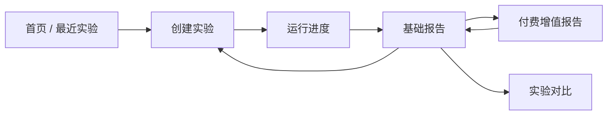
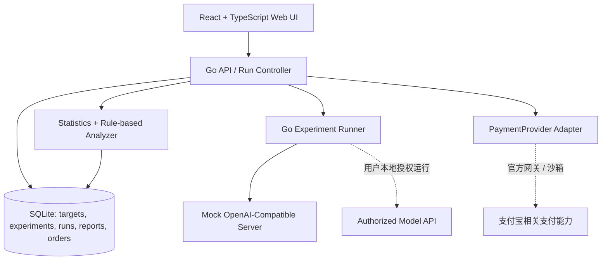

# InferLab — AI 推理服务上线体检平台

> **产品需求文档（PRD）+ 五页面低保真原型 + 技术设计草案**  
> 版本：v0.1 · 日期：2026-11-14 · 状态：供产品验证 / 黑客松 MVP 开发使用  
> 面向：独立 AI 开发者、2～5 人 AI 小团队  
> 产品口号：**Connect → Test → Understand → Improve**（连接 → 测试 → 理解 → 优化）

## 0. 一页摘要

**产品定位**：InferLab 是开源的 AI 推理服务上线前体检工具。开发者提供自己**有权测试**的 OpenAI 兼容 API，或选择不需要 GPU 的 Mock 模式，即可在受控负载下得到可靠、可复现的性能数据，并获得有证据支撑的下一步优化建议。

**核心问题**：开发者往往知道模型能返回答案，却不清楚高峰期会不会变慢、失败率有多高、替换模型/配置后是更好还是更差。

**MVP 要交付的单一闭环**：

1. 选择 Mock 或授权 API；
2. 设置安全的负载计划与服务目标（SLO）；
3. 运行受控测试，显示进度与真实测量数据；
4. 获得基础报告、风险解释，并与基线实验对比；
5. 在满足支付接入资格时，购买并解锁**托管版增值报告**，可重复访问。

**两条产品线**：开源本地版（基础实验、基础指标、基础报告免费）；可选托管版（历史管理、团队共享、深入报告等增值服务）。支付**不是**运行开源核心的必要条件。

**不做什么**：v0.1 不做 Kubernetes Operator、GPU 调度、自研推理引擎、真实生产环境故障破坏、跨节点分布式压测，也不声称通过短时压测证明生产环境绝对安全。

**交付组成**：`InferLab_PRD_v0.1.md`（本文档）、`InferLab_Prototype_v0.1.html`（离线可点击原型）。HTML 原型使用标记清楚的**示例数据**，并不发送真实压测请求或发起支付宝交易。

---

## 1. 用户、任务与成功标准

### 1.1 用户画像

| 用户 | 场景 | 最想得到的结果 | 主要障碍 |
|---|---|---|---|
| 独立 AI 开发者 | 用第三方模型 API 做客服/写作/Agent 应用，即将上线 | “在当前限制下，达到我的延迟目标需要怎样的并发/速率范围？” | 不懂复杂压测脚本，怕额外 API 成本 |
| 2～5 人 AI 团队 | 自托管模型或多供应商服务，准备发布新版本 | “新模型配置是否更稳？出现错误时怎么处理？” | 缺少专职性能工程师与可复现报告 |

### 1.2 用户故事（按优先级）

- **P0 / 上线前体检**：作为开发者，我希望配置 1/5/10/20 并发的阶梯实验，并设置 P95 延迟阈值，以便看到服务在哪个测试阶段不再达标。
- **P0 / 版本对比**：我希望比较两个相同工作负载下的测试，判断变更是否提升了延迟与错误率。
- **P0 / 报告分享**：我希望把测试条件与结果分享给合作开发者，便于复核。
- **P1 / 故障实验**：我希望在隔离 Mock 环境中注入超时或 5xx，观察客户端如何处理。
- **P2 / 集群诊断**：我希望关联服务端 GPU、队列和实例指标，定位瓶颈。

### 1.3 北极星指标与验证指标

- **北极星指标**：每周完成“有效实验并查看结论”的独立开发者数。有效实验必须有完整配置、实际执行记录及可查看报告。
- **激活**：首次进入后在 5 分钟内完成一次 Mock 测试。
- **实用性**：试用用户能否据报告指出至少一个下一步可执行动作。
- **质量**：同一测试配置在相同环境重复运行，得到可解释的波动范围；错误记录可追踪。
- **商业化**：真正发生并完成交付的订单数、报告购买转化率、退款率。绝不使用模拟付款冒充真实交易。

以上目标是待验证的产品假设，并非已取得的数据。

---

## 2. 竞品与差异化判断

| 竞品 / 生态 | 强项 | InferLab 要选择的切入点 | 重要限制 |
|---|---|---|---|
| [GuideLLM](https://github.com/vllm-project/guidellm) | LLM 基准测试与专业性能指标 | 面向非性能专家的“上线体检”引导及可操作解释 | 不能假装 LLM Benchmark 是新能力 |
| [Grafana k6](https://github.com/grafana/k6) | 通用可脚本化负载测试 | 默认提供 AI API 的最小配置与比较报告 | 不自造一套通用压测语言 |
| [genai-bench](https://github.com/sgl-project/genai-bench) | 生成式 AI 性能测试 | 可读的 SLO 结论与产品闭环 | 不以单纯指标种类作为竞争点 |
| [llm-d-inference-sim](https://github.com/llm-d/llm-d-inference-sim) | 无 GPU 的推理行为模拟 | 把模拟测试用于易懂的教学/演示与质量门禁 | “无 GPU”本身不是独创点 |

**初步差异化假设**：让开发者在不理解复杂指标的情况下，按预设负载运行安全测试，并得到“哪些测试阶段满足预设 SLO、下一轮该验证什么”的可追溯结论。**尚需通过真实用户试用和竞品使用体验验证。**

---

## 3. 产品信息架构与全链路



### 3.1 核心对象关系

- **Target（目标服务）**：`mock` 或 `openai_compatible`；标识模型/端点，不存明文密钥。
- **Experiment（实验模板）**：指定目标、负载计划、输入预设、请求超时及 SLO。
- **Run（一次执行）**：某实验实际运行的记录；状态为 `queued / running / succeeded / failed / canceled`。
- **Stage（负载阶段）**：例如并发 1、5、10、20；收集当前阶段各项指标。
- **Report（报告）**：来源于某 Run；有可复核的基础指标与增值分析。
- **Order / Entitlement（订单 / 权益）**：支付系统的业务对象，不能直接依赖前端“支付成功”状态。

### 3.2 核心用户流程

```text
打开产品
  ├─ 立即体验 → 选择 Mock → 配置安全测试 → 运行 → 基础报告
  └─ 接入服务 → 声明已获授权 → 输入 API 目标（及本地凭证）→ 运行 → 基础报告
                                                                    ↓
                                                     设定 SLO + 对比基线
                                                                    ↓
                                                     升级查看托管增值报告
                                                                    ↓
                                           创建订单 → 支付网关 → 服务端验签/查询
                                                                    ↓
                                                         解锁权益 + 再次访问
```

---

## 4. 五个页面：逐屏原型规格

> 本节是**文字线框图与交互定义**；可配合附带的 HTML 原型操作。页面都要有明显的 Demo / Mock 标识，防止示例数据被误认为实测。

### 页面 01：首页 / 仪表盘

**用户目标**：10 秒内理解这是什么，并一键体验；返回用户能查看历史实验。

```text
┌─────────────────────────────────────────────────────────────────────┐
│ InferLab  [首页] [实验] [报告]                          [GitHub]  │
├─────────────────────────────────────────────────────────────────────┤
│ 上线模型之前，先给你的 AI API 做一次体检                          │
│ 输入模型服务 → 阶梯测试 → 识别延迟/错误风险 → 做出上线决策        │
│ [免费体验 Mock 测试]  [连接我的 API]                                │
├─────────────────────────────────────────────────────────────────────┤
│ 产品能回答：最多能到多大负载？是否超出 P95 SLO？版本变更更好吗？│
├─────────────────────────────────────────────────────────────────────┤
│ 最近实验:  名称       目标      状态       P95       [查看报告]    │
└─────────────────────────────────────────────────────────────────────┘
```

**字段与组件**：主 CTA、产品 3 步介绍、最近实验列表、样例报告入口、开源版说明。

**关键交互**：
- 点击 `免费体验` → 创建实验页，预选 Mock。
- 点击 `连接我的 API` → 创建实验页，预选自定义目标。
- 点击历史 Run → 报告页（尚未完成的运行跳到执行页）。

**空状态**：首次使用时显示“还没有实验，试一次免费 Mock”；不伪造历史运行。

**验收**：开发者首次进入 30 秒内能找到创建实验入口；移动端不遮挡主要按钮。

### 页面 02：创建实验

**用户目标**：不需要读文档也能建立一个受控、可复现的性能测试。

```text
┌─────────────────────────────────────────────────────────────────────┐
│ 新建体检：步骤 1/3                                                │
│ 测试目标  (●) 模拟服务  ( ) OpenAI 兼容 API                        │
│ Endpoint [https://... ]  Model [ ... ]  [验证连接]                  │
│ 并发阶梯 [1,5,10,20]  每阶段 [20秒]  总请求上限 [200]             │
│ 单请求超时 [10秒]  最大每秒速率 [5 req/s]                          │
│ SLO: P95 完整响应延迟 < [2000ms] 错误率 < [1%]                    │
│ [✓] 我拥有目标服务的测试授权，理解产生的 API 费用和流量            │
│ [返回]                                       [查看预算] [运行实验] │
└─────────────────────────────────────────────────────────────────────┘
```

**P0 字段**：

| 字段 | 类型 | 建议默认值 | 校验 |
|---|---|---|---|
| `target.type` | 枚举 | `mock` | `mock / openai_compatible` |
| `target.endpoint` | URL | Mock 无需填写 | HTTPS，域名安全策略与出站限制通过后才可测试 |
| `target.model` | 字符串 | `mock-llm` | 不能为空；不构造成未经授权的请求 |
| `load.concurrency_steps` | 正整数数组 | `[1,5,10,20]` | 严格递增，最大阶梯有上限 |
| `load.stage_seconds` | 整数 | `20` | 在产品设定范围内 |
| `load.max_requests` | 整数 | `200` | 全局请求预算硬上限 |
| `load.max_rps` | 数字 | `5` | 独立于并发限制；必须有限制 |
| `load.timeout_ms` | 整数 | `10000` | 合法超时范围 |
| `slo.p95_e2e_ms` | 整数 | `2000` | 大于 0 |
| `slo.error_rate_max` | 比例 | `0.01` | 0 到 1 |

**关键交互**：
- Mock 目标不需要密钥；真实目标需校验授权及安全限制。
- 点击 `查看预算` 显示**最大请求次数、最长估计持续时间**；真实第三方账单费用无法精确计算时必须明确说明。
- `运行实验` 前校验所有字段；超出安全预算则阻止开始。
- 实验运行后，配置与测试版本应固化，后续修改创建新 Run 或新模板版本。

**安全设计**：生产托管服务不允许任意 URL 压测。默认限制外网目标、拦截内网/本机/云元数据地址与重定向穿透；优先采用**用户本地 Runner** 对真实 API 发请求。服务端不保存明文 Key；日志不包含 Prompt、Token 或授权头。

**验收**：Mock 模式在 60 秒内完成表单；不合法 URL、无授权勾选、过大测试预算都被阻止。

### 页面 03：运行实验 / 实时状态

**用户目标**：确认测试确实在执行，而不只是播放动画；知道何时完成或失败。

```text
┌─────────────────────────────────────────────────────────────────────┐
│ 实验运行中  [停止]                                                 │
│ 阶段 2/4：并发 5                  进度 ███████░░░ 67%             │
│ 已发送 68 / 最大 200    成功 65    失败 3                          │
│ 实时请求速率 4.6 req/s   当前阶段 P95 820ms                       │
│ 事件时间线：开始 → 阶段1完成 → 阶段2开始 → ...                       │
│ [查看原始事件]                                      [完成后看报告] │
└─────────────────────────────────────────────────────────────────────┘
```

**显示字段**：Run ID、工作负载快照、阶段、发送数、完成数、错误数、近窗口速率、事件日志、停止按钮。

**状态**：`queued`（等待）、`running`（执行中）、`succeeded`（完成）、`failed`（执行异常）、`canceled`（人为停止）。

**关键交互**：
- 页面刷新后可根据 Run ID 恢复显示。
- 停止操作应中止后续请求，尽可能取消本地任务，并在数据库记录取消状态。
- 真实模式显示采样时刻、最新更新时刻；断线时明确提示数据暂不可用。
- 对失败 Run 给出失败原因与可重试入口，但不能把失败当作 0% 错误率。

**验收**：运行状态能与后端事件一致；取消后不再继续发新的压测请求；页面刷新不丢失 Run。

### 页面 04：体检报告 / 版本对比

**用户目标**：快速看见哪些阶段达标、风险证据是什么、下一步该验证什么。

```text
┌─────────────────────────────────────────────────────────────────────┐
│ 报告 #RUN-001    [Mock 演示]  [重新运行] [对比历史]               │
│ 服务目标：P95 < 2000ms，错误率 < 1%                               │
│ 总请求 180   成功率 98.3%   总体 P95 1820ms                        │
│ 关键结论：高并发阶段出现 SLO 超限，需复测后确认瓶颈              │
│                                                                    │
│ 阶段          1        5        10       20 （并发）               │
│ P95(ms)      420      700      1150     2650                    │
│ 错误率        0%       0%       0.5%     2.3%                    │
│                                                                    │
│ 证据：并发 20 阶段 P95 高于 2000ms 门槛                           │
│ 建议：固定输入和采样窗口，重复 10～20 并发实验                    │
│ [基础报告已包含指标] [查看增值分析]                                │
└─────────────────────────────────────────────────────────────────────┘
```

**基础报告（免费）**：完整测试配置、工作负载规模、阶段统计、P50/P95、吞吐量/错误率、阈值达标状态、可复核指标说明。

**增值报告（托管付费假设）**：长期历史保存、跨版本对比、多轮实验摘要、团队共享链接、扩展的改进计划。开源本地版保留基本报告能力。

**核心计算口径**：
- `e2e_latency_ms`：从客户端发起至拿到完整响应的耗时；流式请求测到结束标志为止。
- `TTFT`：仅对流式响应且可观察首个输出 Token 的情况统计；否则显示 `N/A`。
- `TPOT`：仅在输出 Token 数及时间足够可靠时计算；否则显示 `N/A`。
- `throughput_rps`：观察窗口内**完成**的请求数 / 窗口秒数。
- `error_rate`：按定义明确的失败次数 / 已完成的总次数；取消运行需单独列出，不能静默剔除。
- `P95`：对实际采样值计算，不用多阶段 P95 再简单平均成总体 P95。
- `SLO_status`：按阶段判断达标/不达标/样本不足，避免仅凭短暂测试作绝对上线承诺。

**对比原则**：同样输入分布、相近时段、相同压测配置才适合直接比较；不具备可比性时显示醒目标注。

**验收**：每个建议可追溯到至少一个指标和阶段；不能凭客户端数据断言“GPU OOM”或“KV Cache 不足”，只能作为待验证假设。

### 页面 05：付费解锁 / 权益交付

**用户目标**：理解自己购买什么，支付后可以正常访问已经获得的服务。

```text
┌─────────────────────────────────────────────────────────────────────┐
│ 获取高级分析报告                                                   │
│ 基础报告：免费（性能指标、SLO 阶段结果、基础建议）                │
│ Pro：¥9.9 / 份（建议测试价）                                       │
│  ✓ 多轮对比摘要   ✓ 更完整的优化行动清单   ✓ 历史托管访问          │
│ [支付宝支付]   [稍后再说]                                           │
│ 支付状态：待支付 / 确认中 / 已支付 / 失败 / 已退款                 │
│ 已支付 → 服务端验证订单 → 交付报告权益 → 可再次访问                │
└─────────────────────────────────────────────────────────────────────┘
```

**支付方案**：当前优先评估面向 Web 应用的支付宝支付接入（此前讨论为 Vibe Pay 赛道），**以实际赛事规则、开放平台接入资格和官方接口为准**。当前并未核实个人账号一定有正式收款权限。

**订单状态**：`created → pending → paid → fulfilled`，旁支 `failed / closed / refunded`。

**可靠性要求**：服务端验签/查单、校验订单号/金额/币种/商户、幂等处理回调、权益单独记录；前端跳转页只是提示，不是支付成功证据。沙箱付款要明确写“测试”，不可作为真实销售成绩。

**降级策略**：如果正式支付资格未获批，交付功能可在比赛演示里使用**明确标注的支付沙箱**；不要假装已产生真实订单。完整报告购买功能的交付，以正式接入通过为前置条件。

**验收**：重复支付通知只生成一次权益；退款后按条款调整权限；用户能重新登录/访问所购报告。

---

## 5. 信息架构之外的关键体验设计

### 5.1 异常与空状态

| 场景 | 产品处理 |
|---|---|
| API Key 无效 | 明确提示身份校验错误，不在日志输出密钥 |
| 目标不可达 | 显示具体类型（DNS/连接/超时），建议检查本地网络或目标授权 |
| 模型返回 429 | 统计限流响应，与普通网络异常分开显示 |
| 部分阶段样本太少 | 报告标记“数据不足”，不推导容量结论 |
| 运行过程中关闭页面 | 后台继续执行或按配置停止；回到页面可查状态 |
| 支付成功页面加载失败 | 后端仍可依据订单确认结果发放权益 |
| 实验超过预算 | 自动停止并告知是否为时间、请求数或成本限制 |

### 5.2 设计原则

1. **先给结论，再给证据**：首页只解释用户价值，报告先展示 SLO 判断，再展开专业指标。
2. **真实、模拟严格区分**：所有模拟数据使用 `MOCK` 标签，不能与实测结果混排。
3. **不做无依据诊断**：将“观察到的现象”和“建议验证的假设”分开。
4. **安全默认开启**：流量、请求、时长、并发有硬限制；不发送未授权目标流量。
5. **渐进式复杂度**：初次用户只需要默认模板，高级用户才展开详细参数。

---

## 6. 技术架构草案（适配 macOS 16GB）



**第一版建议**：
- 前端：React + TypeScript + Vite；页面可先通过简洁 CSS 开发。
- 后端：Go 标准 `net/http`（或轻量路由库）；Worker Pool 和基于 `context` 的取消逻辑。
- 数据库：SQLite；实验配置 JSON 快照，汇总指标按阶段持久化。
- 结果展示：基础 SVG / 图表库；图表必须与实际指标数据绑定。
- 模拟器：本地 HTTP Mock 服务，支持可配置响应延迟、错误率和请求计数。
- 安全：默认本地运行，真实 API 的密钥仅放本机环境变量或本地安全配置；托管运行另做安全审查。

**不建议在黑客松 MVP 中引入**：Kubernetes、Redis、Kafka、微服务拆分、GPU 服务；这些留作开源路线图。

### 6.1 核心接口抽象（Go 伪代码）

```go
type InferenceTarget interface {
    Invoke(ctx context.Context, request InferenceRequest) (InferenceResult, error)
}

type ExperimentRunner interface {
    Run(ctx context.Context, experiment Experiment) (RunSummary, error)
    Cancel(runID string) error
}

type ReportAnalyzer interface {
    Analyze(run RunSummary, slo ServiceLevelObjective) Report
}

type PaymentProvider interface {
    CreateOrder(ctx context.Context, order Order) (PaymentSession, error)
    VerifyNotification(ctx context.Context, message []byte, headers map[string]string) (PaymentEvent, error)
}
```

`Run` 是一次不可变配置下的执行记录；运行器必须同时约束**并发、请求速率、最大请求数、持续时间**，避免“限制并发却无限高频发送”的问题。

---

## 7. API 设计草案

前缀：`/api/v1`。所有 API 返回结构化错误：`{ "error": {"code": "...", "message": "..."} }`。

| 方法 | 路径 | 作用 | MVP |
|---|---|---|---|
| `GET` | `/healthz` | 健康检查 | P0 |
| `GET` | `/targets` | 可选测试目标 | P0 |
| `POST` | `/targets` | 配置目标（不得提交明文 Key 到服务端存储） | P0 |
| `POST` | `/experiments` | 创建实验模板 | P0 |
| `GET` | `/experiments/{id}` | 查询配置 | P0 |
| `POST` | `/experiments/{id}/runs` | 启动一次执行 | P0 |
| `GET` | `/runs/{id}` | 读取状态与汇总 | P0 |
| `POST` | `/runs/{id}/cancel` | 停止执行 | P0 |
| `GET` | `/runs/{id}/events` | 运行事件（可选 SSE） | P0 |
| `GET` | `/runs/{id}/report` | 基础报告 | P0 |
| `GET` | `/reports/{id}/compare?baseline_run_id=...` | 版本对比 | P0/P1 |
| `POST` | `/orders` | 创建增值报告订单 | 赛事版 P0* |
| `GET` | `/orders/{id}` | 查询服务端订单状态 | 赛事版 P0* |
| `POST` | `/payments/notify` | 官方支付结果回调 | 赛事版 P0* |
| `GET` | `/reports/{id}/premium` | 校验权益后提供增值报告 | 赛事版 P0* |

`*` 支付相关接口以实际接入资格与官方接口定义为前置条件，不能直接按伪接口上线。

**创建实验请求示例**：

```json
{
  "name": "Customer Support API - Release Candidate",
  "target_id": "mock-default",
  "workload": {
    "concurrency_steps": [1, 5, 10, 20],
    "stage_seconds": 20,
    "max_requests": 200,
    "max_rps": 5,
    "timeout_ms": 10000,
    "prompt_profile": "short-qa"
  },
  "slo": {
    "p95_e2e_ms": 2000,
    "error_rate_max": 0.01
  }
}
```

**运行结果响应示例**（以下数值仅为样例）：

```json
{
  "run_id": "run_demo_001",
  "experiment_id": "exp_demo_001",
  "status": "succeeded",
  "source_type": "mock",
  "result_kind": "demo",
  "request_count": 180,
  "completed_count": 180,
  "success_count": 177,
  "error_count": 3,
  "stage_summaries": [
    {"concurrency": 1, "p95_e2e_ms": 420, "error_rate": 0.0},
    {"concurrency": 5, "p95_e2e_ms": 700, "error_rate": 0.0},
    {"concurrency": 10, "p95_e2e_ms": 1150, "error_rate": 0.005},
    {"concurrency": 20, "p95_e2e_ms": 2650, "error_rate": 0.023}
  ],
  "note": "Illustrative sample only; not measured from a live endpoint"
}
```

注意：上面的 JSON 只是响应结构示意；真实阶段统计、总计数必须来自同一组原始采样，不能沿用示意数字。运行器应明确区分模拟样本与真实 API 样本。

### 7.1 错误码建议

- `INVALID_EXPERIMENT_CONFIG`：参数不符合允许范围。
- `TARGET_NOT_AUTHORIZED`：尚未完成授权确认。
- `TARGET_BLOCKED`：目标不符合出站安全策略。
- `RATE_LIMITED`：达到测试请求速率上限。
- `RUN_ALREADY_FINISHED`：取消已完成的 Run。
- `ORDER_NOT_VERIFIED`：订单未通过服务端核验。
- `PAYMENT_NOT_CONFIGURED`：正式支付接口未就绪。

---

## 8. SQLite 数据结构（最小草案）

初版建议单机运行，未来多用户/多实例时迁移关系数据库。下面是**原型模型**，正式迁移需补充外键约束、迁移脚本、用户鉴权与索引策略。

```sql
CREATE TABLE targets (
  id TEXT PRIMARY KEY,
  name TEXT NOT NULL,
  type TEXT NOT NULL CHECK(type IN ('mock', 'openai_compatible')),
  endpoint TEXT,
  model TEXT NOT NULL,
  created_at TEXT NOT NULL
);

CREATE TABLE experiments (
  id TEXT PRIMARY KEY,
  name TEXT NOT NULL,
  target_id TEXT NOT NULL REFERENCES targets(id),
  config_json TEXT NOT NULL,
  created_at TEXT NOT NULL
);

CREATE TABLE runs (
  id TEXT PRIMARY KEY,
  experiment_id TEXT NOT NULL REFERENCES experiments(id),
  status TEXT NOT NULL,
  config_snapshot_json TEXT NOT NULL,
  source_type TEXT NOT NULL,
  started_at TEXT,
  finished_at TEXT,
  error_code TEXT,
  summary_json TEXT,
  created_at TEXT NOT NULL
);

CREATE TABLE reports (
  id TEXT PRIMARY KEY,
  run_id TEXT NOT NULL UNIQUE REFERENCES runs(id),
  basic_report_json TEXT NOT NULL,
  premium_report_json TEXT,
  analyzer_version TEXT NOT NULL,
  created_at TEXT NOT NULL
);

CREATE TABLE orders (
  id TEXT PRIMARY KEY,
  report_id TEXT NOT NULL REFERENCES reports(id),
  provider TEXT NOT NULL,
  provider_order_id TEXT UNIQUE,
  amount_fen INTEGER NOT NULL,
  currency TEXT NOT NULL DEFAULT 'CNY',
  status TEXT NOT NULL,
  created_at TEXT NOT NULL,
  updated_at TEXT NOT NULL
);

CREATE TABLE entitlements (
  id TEXT PRIMARY KEY,
  order_id TEXT NOT NULL UNIQUE REFERENCES orders(id),
  report_id TEXT NOT NULL REFERENCES reports(id),
  entitlement_type TEXT NOT NULL,
  status TEXT NOT NULL,
  granted_at TEXT NOT NULL
);
```

**隐私规则**：不把原始 Prompt、明文 API Key、Authorization Header 写入数据库或实验分享页。可记录摘要、长度分布、运行时环境、模型标识、负载参数等非敏感元数据。共享报告必须提供脱敏开关。

---

## 9. 黑客松商业方案与演示

### 9.1 定价（仅为待验证假设）

| 层级 | 暂定价格 | 权益 |
|---|---:|---|
| Open Source / Free | ¥0 | 本地模拟、授权 API 基础测试、基础报告 |
| Pro Report | ¥9.9 / 份 | 托管历史、扩展风险摘要、改进清单 |
| Compare Pack | ¥29.9 | 多轮实验分析、版本对比、可共享报告 |

**待验证问题**：独立开发者是否愿意付费？付费报告相对开源版是否有清晰的新增价值？云端流量和第三方模型成本能否覆盖？

### 9.2 四分钟演示（建议）

| 时间 | 演示 | 评委应该理解什么 |
|---|---|---|
| 0:00–0:30 | 一个 AI 客服开发者要上线，不知道 API 能否扛住用户增长 | 痛点具体 |
| 0:30–1:10 | 选择 Mock / 授权服务，输入 SLO，创建实验 | 体验简单 |
| 1:10–2:00 | 展示一轮真实运行的小型实验，实时阶段与指标 | 产品不是静态 PPT |
| 2:00–2:40 | 打开报告，展示 P95 超线证据与下一轮建议 | 结果可执行 |
| 2:40–3:20 | 依据实际接入条件展示正式支付闭环；否则明确标记支付沙箱 | 商业闭环真实且合规 |
| 3:20–4:00 | 简述 Go Runner / GitHub 开源、试用用户反馈与路线图 | 交付能力与长期价值 |

**应急方案**：预先保存一份**真实运行产生**的实验记录；现场失败时如实说明，并用历史记录演示。不得把预录或 Mock 数据称为现场实测。

### 9.3 赛事适配注意

- 先核验参赛赛道、资格、支付产品接入条件与提交截止；此前讨论 PAYATHON 2026 与 Vibe Pay，但本文件不将外部资格视为已获批。
- 若要展示真实商业结果，必须来自真实用户、真实交易及真实服务交付。
- 把支付功能隔离成适配器，确保未通过准入时仍能演示**非付费的真实产品能力**。

---

## 10. 开发拆解和验收标准

### 10.1 适合个人的 4 个迭代

| 迭代 | 交付范围 | 完成定义 |
|---|---|---|
| Sprint 1 | 首页、创建实验、Mock API、Go 阶梯测试 | 本地能跑一次并生成真实采样 |
| Sprint 2 | 运行进度、SQLite 持久化、基础报告 | 刷新/重启仍能查 Run 与结果 |
| Sprint 3 | 对比报告、规则建议、授权 API 的本地 Runner | 真实与模拟结果明确分离，安全限制生效 |
| Sprint 4 | 托管增值报告、支付适配器、文档与演示 | 凭证核验及权益闭环可审计；无资格时不伪造正式收款 |

### 10.2 P0 验收测试

1. 新用户点击 Mock 体验，能完成创建 → 运行 → 报告全链路。
2. 负载计划的并发、RPS、总请求数、单次超时和总时长均受硬限制。
3. 任一阶段失败或用户停止时，Run 状态、错误码和已完成指标一致。
4. 报告可区分每阶段 P95、总体 P95、RPS 与错误率，并展示计算口径。
5. 同一实验可执行多次，运行参数快照不会被之后编辑的模板修改。
6. 基线对比只在可比工作负载下给出可解释判断。
7. Mock 数据始终带 `Mock / 示例` 标签；真实数据从执行采样生成。
8. 用户密钥和原始 Prompt 不出现在日志、数据库、分享报告中。
9. 非法目标、内网敏感地址、超预算请求被禁止；未经授权的目标不可测试。
10. 已支付权益只由后端订单确认产生；重复通知不可重复发放。
11. 系统具备基本测试、错误处理、健康检查、启动文档和 LICENSE。
12. README 中清楚说明实验限制、隐私与授权测试责任。

### 10.3 非功能要求（MVP）

- **设备**：macOS 16GB 能运行 Web + Go + SQLite + Mock，无需 GPU。
- **可复现**：记录配置、软件版本、时间窗口、请求样本数与采样来源。
- **性能**：先做个人小规模受控测试，不宣称生产级压测容量。
- **安全**：仅测试自己拥有或明确获授权的服务；本地优先，托管目标严格审核。
- **可维护性**：基础 CI（构建/测试/格式）、Issue 模板、示例配置、贡献指南。

---

## 11. GitHub 开源交付建议

```text
inferlab/
├── apps/web/                  # React + TypeScript UI
├── cmd/server/                # Go API 服务
├── cmd/runner/                # Go 本地测试执行器
├── internal/
│   ├── experiment/            # 实验管理
│   ├── runner/                # 并发、速率、取消、阶段控制
│   ├── targets/               # Mock / OpenAI-Compatible adapter
│   ├── metrics/               # 统计及口径
│   ├── reports/               # SLO、规则与报告
│   ├── storage/               # SQLite Repository
│   └── payments/              # 可选支付适配器
├── examples/                  # 默认 Mock 场景
├── docs/                      # 架构、API、威胁模型、截图
├── tests/                     # 集成、并发、异常测试
├── .github/workflows/         # CI
├── LICENSE
├── CONTRIBUTING.md
└── README.md
```

开源策略：优先 Apache-2.0 或 MIT（正式公开前确认依赖许可）。第一版 README 包括：用户问题、30 秒 Mock Demo、架构图、指标口径、已知限制、运行截图、贡献入口。

---

## 12. 尚未决定的产品问题与决策建议

| 问题 | 当前建议 | 需要验证的证据 |
|---|---|---|
| 第一批用户用什么模型？ | 优先 OpenAI-Compatible API | 访谈 5～10 位目标开发者 |
| 报告是否应该收费？ | 基础免费，托管增值收费 | 试用后真实购买意愿 |
| 真实 API 压测从哪里发起？ | 用户本地 Runner 优先 | 网络安全、隐私与使用成本 |
| 是否需要 AI 自动诊断？ | 先规则引擎，后 LLM 文案 | 错误诊断率与用户理解度 |
| 是否立即支持 Kubernetes？ | 否，放到开源路线图 | 有真实用户需要多实例/GPU 监控 |
| 支付采用哪种方式？ | 评估 Web 收款路径 | 官方资格/赛道和接口审批 |

### 最紧要的三个下一步

1. 邀请至少 3 位目标用户阅读这份页面流程，观察是否能复述 InferLab 的价值。
2. 以 Mock 实验打通创建、执行、报告三步，确保**真正产生测量数据**而不只是前端动画。
3. 核实支付接入资格与官方规则，再决定赛事里能演示正式支付还是必须标注为沙箱。

---

## 附录：本文档边界

- 本文是**基于当前产品讨论形成的设计建议**，不代表任何赛事方的确认意见，也不代表已完成开发或市场验证。
- 所有演示数值、价格均为**示意/假设**，必须在正式页面和提交材料里明确标注。
- 第三方仓库链接用于学习竞品，不代表 InferLab 已集成或获得其背书。
- 具体支付 API、资格及时间要求需要以官方最新文档和当前赛事规则核验。
