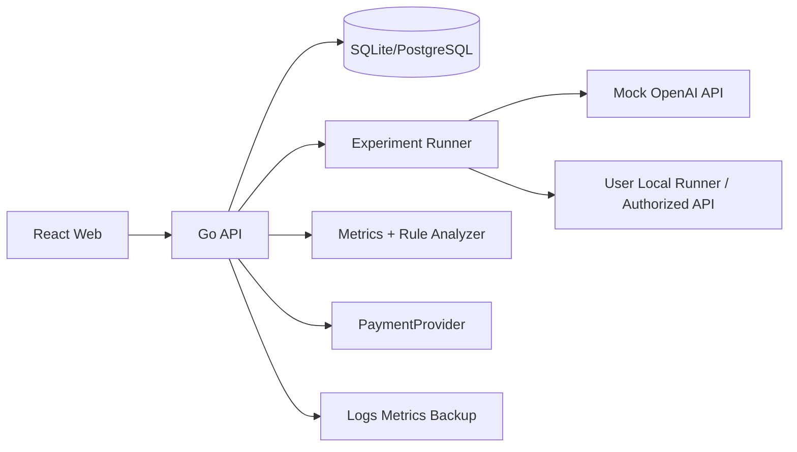

# 系统架构

状态：`accepted`

## 组件

第一阶段使用单体 Go 服务、独立 Runner 模块、SQLite 和 React 前端。部署时可以由 Go 服务托管构建后的静态资源，反向代理负责 HTTPS、域名和基础限流。

## 边界

- API 负责鉴权、实验配置、Run 生命周期、报告读取和订单状态。
- Runner 负责真实请求、并发/速率/预算约束、阶段事件和取消。
- Analyzer 只基于采样数据和明确规则生成报告，不凭客户端指标推断 GPU OOM 等服务端事实。
- PaymentProvider 隔离支付宝/VibePay 和未来其它支付渠道。
- 真实 API 默认由用户本地 Runner 发起；云端真实目标需要单独的出站安全审查。

## 数据流约束

实验模板创建后，启动 Run 时保存不可变配置快照。阶段指标来自原始采样；总体 P95 不能通过阶段 P95 平均得到。Run 的状态必须由后端事件和持久化记录驱动，前端刷新不能丢失状态。

## 演进

单体版本验证用户价值后，再拆分 Job Worker、PostgreSQL、对象存储和队列。拆分前不引入微服务、Redis 或 Kubernetes，以免把部署复杂度提前引入。
