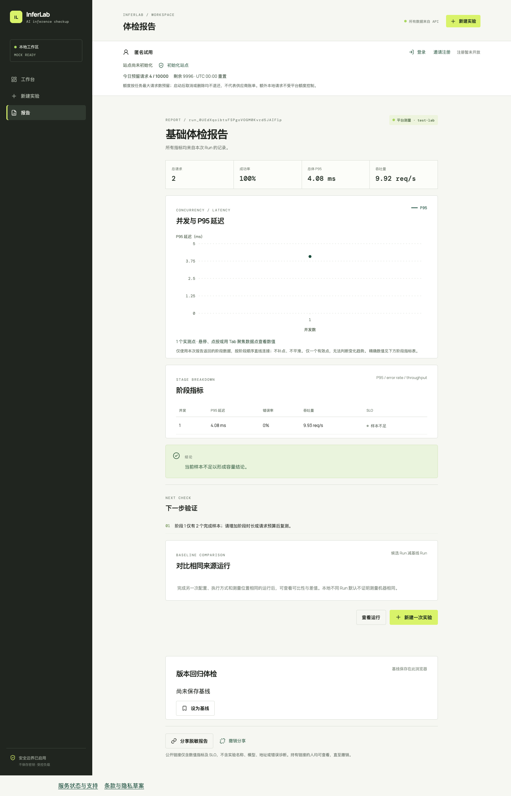
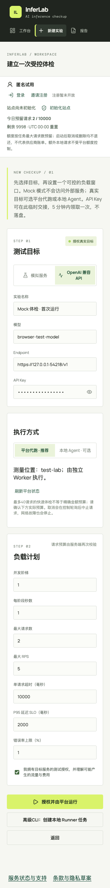
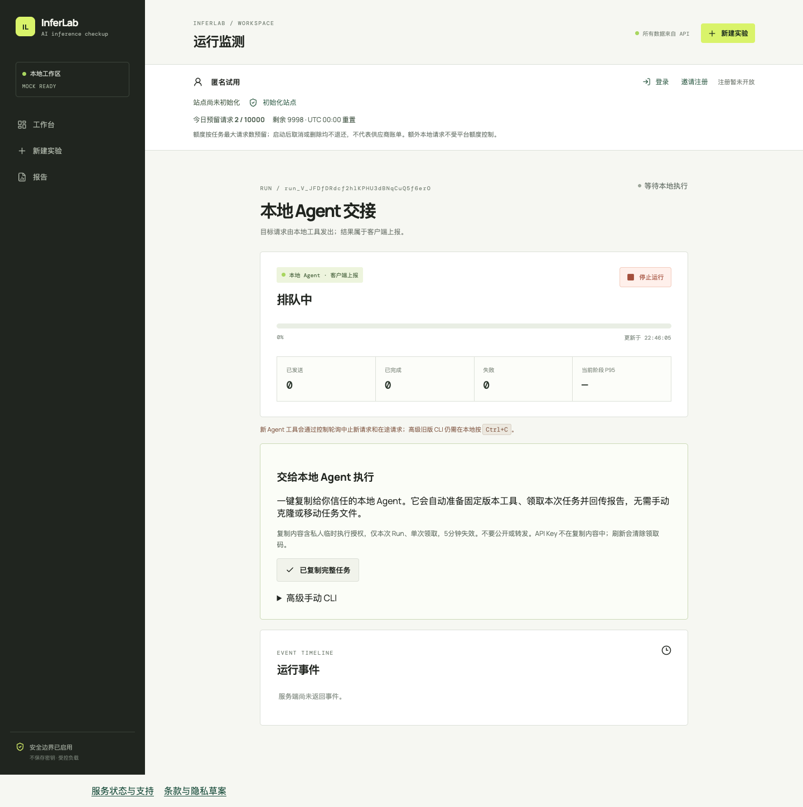

# 平台代跑与本地 Agent 交接

状态：本地实现和验收通过，[PR #11](https://github.com/Leon-KTlan/inferlab/pull/11) 待主架构审查；待staging，不代表已上线。基线固定为 `4ea482b22b2833544beb5abbde1360a3c2a2a3bb`，分支 `codex/feature/dual-execution`，堆叠依赖 PR #10（codex/feature/report-charts）。原目录及图表工作树的未提交改动未触碰，无真实供应商调用、云端资源/生产改动或支付改动。

## 改动

- `services/api/dual_execution.go`、`execution_client.go`：新双模式入口、独立Worker命令、单次私人领取码、内存凭据与任务租约、TTL/配额/取消/重启状态。复用现有受控执行内核，不在网页请求内同步压测。
- `apps/web/src/ExecutionPanel.tsx`、`agent-handoff.ts`、`runner-release.ts` 与 App/API：显式选择执行方式与授权，平台位置/不可用原因，一键复制完整自然语言指令，来源标签及刷新报告恢复。新Agent支持远程取消；旧文件协议保留高级入口。
- `infra/worker*` 与最小Nginx示例：独立容器、默认拒绝私网/宿主/metadata、降权且capabilities归零，独立TLS控制服务；不公开所有runner-tasks/internal接口。
- `docs/specs/013-dual-execution.md` 扩展009；Run JSON新增不可变execution快照，无schema迁移。真实来源/位置不匹配拒绝比较，旧-旧比较保留兼容说明。

## 实测证据

2026-11-20（America/Los_Angeles）最终执行：

```bash
BROWSER_PYTHON=/tmp/inferlab-dual-browser/bin/python scripts/dual_execution_acceptance.sh
```

GitHub代码提交d936388的Go API、React web、Browser smoke、Container build四项检查全部通过，见 [CI证据](evidence/github-ci.json)。后续文档记录提交不改变被测试代码。

结果在 [acceptance.json](evidence/acceptance.json)：Go vet、152项Go测试（含子测试）、race、前端lint/typecheck/build/test（7文件21测试，原18项保留）、固定公开源码摘要与构建、双模式TLS浏览器、Docker镜像与网络/降权探针全部通过。lint实际是tsc，不是ESLint。当前本机Node23.11.0可通过，Vitest安装曾提示推荐Node20/22/24；自托管建议用22或24。本机Go、Docker Linux VM与Chrome完成验证；Windows未实际运行。

[浏览器结果](evidence/browser-result.json)：真实 API→Worker入口/Agent CLI入口→受控TLS假上游→指标→报告/图表；每种2次成功请求，无供应商调用。测试通过私有构造参数提供TLS根和回环目标；生产没有放开SSRF/TLS的开关。Worker入口在测试内经真实HTTP领取/回传；生产以独立进程/容器运行，容器隔离另以实际探针验证。1440/390/320px无横向溢出，刷新同一Run后图表保留，页面JS错误0；API Key、领取码、长期令牌均不在浏览器存储或复制文本中的敏感值字段，复制内容只带明确标记的短期私人领取码。

原 `scripts/ui_smoke.py` 全部断言保持不变并运行通过，包含高级CLI下载、任务文件脱敏、复制命令、刷新后令牌清除、取消记录及错误诊断。高级入口明确标为手动CLI，新双模式仍是主要流程。

补充执行原 `apps/web/tests/report_charts_smoke.py`：仅将浏览器启动环境选为本机Chrome，原断言/执行器不改动。真实Mock四阶段、Tab焦点、刷新、空/单点/零/缺失图表均通过，结果见 [Mock回归](evidence/mock-charts/result.json)。Chromium自动下载网络失败后改用已安装Chrome，未把失败下载算通过。

[安全回归](../../specs/013-dual-execution.md)：目标授权、并发原子预留/领取、同用户/平台/目标限制、终态后重放、过期/跨用户领取、API重启撤销、Worker失联不重排、两模式取消在途、慢结果不阻塞取消、混合DNS/重绑定/私网/metadata/重定向陷阱、存储故障时清除过期凭据、DB/输出脱敏、来源比较。原测试无删除、弱化或跳过。慢结果的真实失败与修复记录见 [RED_GREEN](RED_GREEN.md)。

[隔离探针](evidence/worker-isolation.txt)：真实包命中DROP规则；UID/GID65532，CapEff/CapBnd均0。不能用本地探针替代staging实际网络验收。

[固定源码](evidence/pinned-source.json)：公开提交 `35424119f07c3cdb7e00efc8ec5fc863b02213eb`，codeload归档SHA-256 `73f21b247b14109ece086fdc88d227cee2775664ee12040b9b25e9ec9f03a59d`，已从公开地址重新获取、检查路径/链接安全并构建通过；没有latest或curl|sh。后续更新执行工具必须同步固定提交与摘要。

## 预览与操作

```bash
scripts/dual_execution_preview.sh
```

启动 `http://127.0.0.1:4186` 的全新临时数据库和本地网页，退出自动清理；默认平台关闭，网页明确说明并允许用户选择本地。双模式受控假上游端到端由统一验收脚本自动跑完，截图如下。平台启用、最小代理、隔离命令及回滚见 [RUNBOOK](RUNBOOK.md)。先决依赖为Go、前端node_modules、Python Playwright、Chrome及Docker；本工作树已准备并运行通过。普通预览不需要Python或Docker。





## 风险和后续依赖

单API实例、平台仅1个任务；没有多副本调度或Redis。取消存在250ms轮询与750ms控制请求超时的有限延迟，网络故障即停止；API/Worker重启必须重新提交，绝不自动重发。请求数和32输出token限制不保证精确金额；快速预算不一定满足严格回归比较的完整阶段要求。本地报告是客户端上报，不证明机器身份。Go字符串不保证物理内存清零，API只在受限内存短存凭据，终态/过期/重启释放引用。

平台隔离配置仅放行公网IPv4 TCP443、Docker DNS和专用TLS控制IP；其它端口/IPv6需本地方式。合并前修复 Docker DNS DNAT 放行并补真实网络回归；代理 IP 的失败桶只限制无效领取，有效单次码仍须校验任务、账户绑定和过期状态，验证见 RED_GREEN。旧手动CLI网页取消仍需本地Ctrl+C；新Agent不同。本机准备流程已在macOS验证源码构建，跨OS的自动准备仍应另做真实用户机器验收。

[BLOCKED](BLOCKED.md)：本地无阻塞；待staging HTTPS/邀请账户/最小代理/独立Worker实际网络与地域验收，以及用户明确授权的真实供应商Endpoint/模型/预算。本次不合并、不部署。回滚可关闭平台并停止Worker，然后回滚本PR并重建；无新增schema或破坏性迁移，部署仍遵守既有备份门禁。
