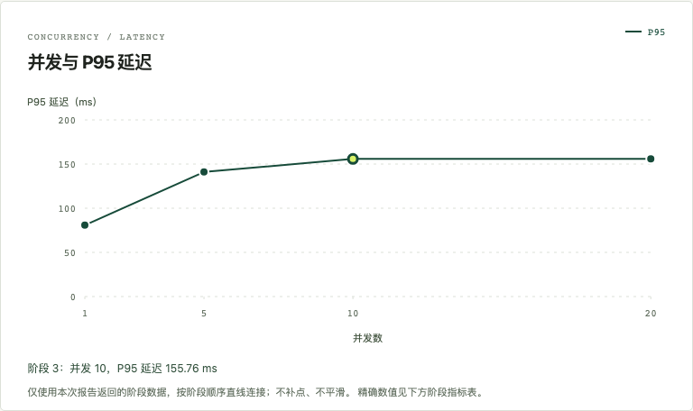
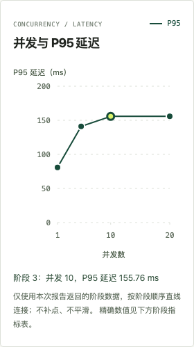

# 基础报告阶段图表验收记录

状态：本地实现与验证通过，待主架构会话审查和 staging 验收。未部署、未合并。

基线：Beta 提交 `b09093613c9e1c989cb67f81c561f5248d18b0d0`，PR 依赖版本回归 PR #9，目标分支为 `codex/feature/version-regression`。隔离工作树未包含两个原工作树中的未提交变更。

## 范围与约束

- 在私有基础报告的指标卡与阶段表格之间展示并发数—P95 延迟；沿用绿色、纸白色和现有字体。原表格与 Mock 标识保留。
- 只读取 `report.stages` 的 `concurrency`、`p95_e2e_ms` 和 `completed_count`，不更改 API、缓存或持久化。并发按现有 API 契约严格递增，横轴按数值比例定位。
- 原生 SVG，无新增依赖。有效阶段直接连直线，不生成时间序列、不平滑、不补点。缺失、非数值、非有限或负延迟，以及 `completed_count === 0` 的阶段不绘制并断线；并发必须是正整数。
- 空数据给出说明；单点居中且无趋势线；有完成样本的 0 ms 保留，全零数据使用 0–1 ms 轴域避免除零。
- ResizeObserver 适配宽度，仅省略拥挤的横轴刻度，不省略数据点。点支持 Tab、悬停和点按读取；SVG 描述列出所有有效数值，下方表格仍可精确查阅。
- 本次不增加吞吐量/错误率切换，不改公共分享报告、回归比较、支付、认证、部署或数据库。

## 验证

Node 24.22.1，从仓库根目录执行：

```bash
cd apps/web
npm ci
npm run lint
npm run typecheck
npm run build
npm test
cd ../..
python3 apps/web/tests/report_charts_smoke.py
git diff --check
```

2026-11-20 本地结果：lint/typecheck/build 全通过，6 个测试文件、18 项单元测试通过（含 4 项图表测试）。浏览器脚本复用现有 `stage3_smoke.Fixture`，在临时 SQLite 和随机 loopback 端口运行真实 Go Mock Runner，结束后清理服务和数据库；需要 Go、Python Playwright 和 Chromium。

实际 Run：`run_5w6rBcERyVg56QsieJnUwReifyQaUasP`。并发 1/5/10/20 对应 P95 为 80.767/141.001/155.759/155.851 ms，完成请求数为 31/74/78/78；仅是本次本地 Mock 结果，不代表真实模型性能。浏览器逐点核对 API 返回值，验证图表在指标卡与表格之间、Mock 标识、Tab 读取、刷新后恢复，以及 1440/390/320px 无页面横向溢出。额外的空数据、单点、全零、缺失断线采用明确的报告响应测试夹具，与下面真实 Mock 截图分开；页面 JS 错误为 0。





完整运行证据由脚本输出至 `/tmp/inferlab-report-charts-evidence/`，可用 `--output` 指定目录，包括报告/图表截图、边界夹具截图和 `result.json`。本次执行的完整证据保留在当前会话可视化目录的 `report-charts/` 下。

## 风险、配置和回滚

无配置或迁移。使用当前浏览器原生 SVG/ResizeObserver；公开分享报告仍保持原展示。上线验证由主架构会话接续，本任务未进行 staging 或生产操作。回滚时撤销本 PR 的单个功能提交并重新构建前端即可，不涉及数据回滚。
